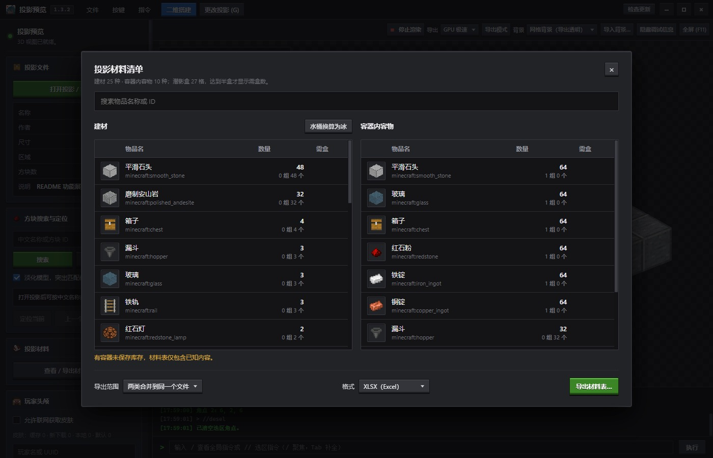
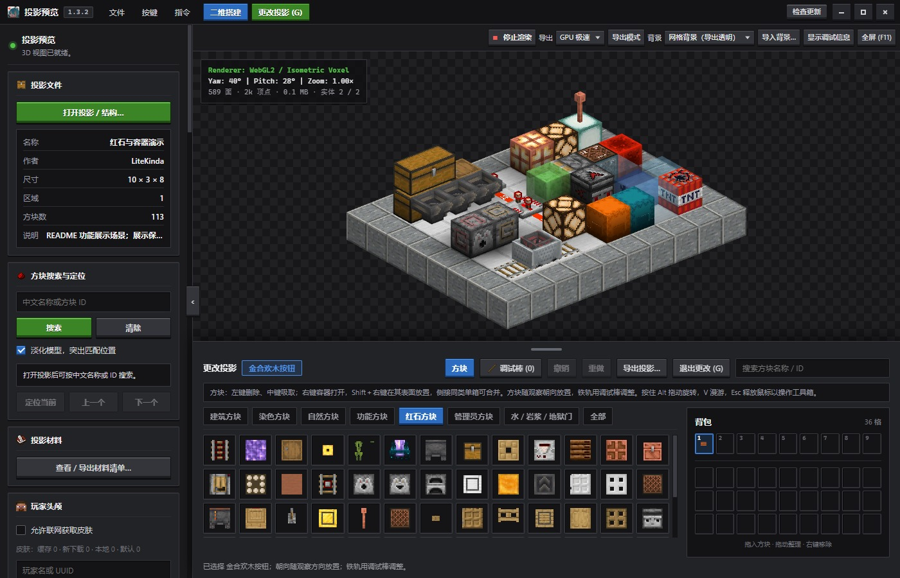
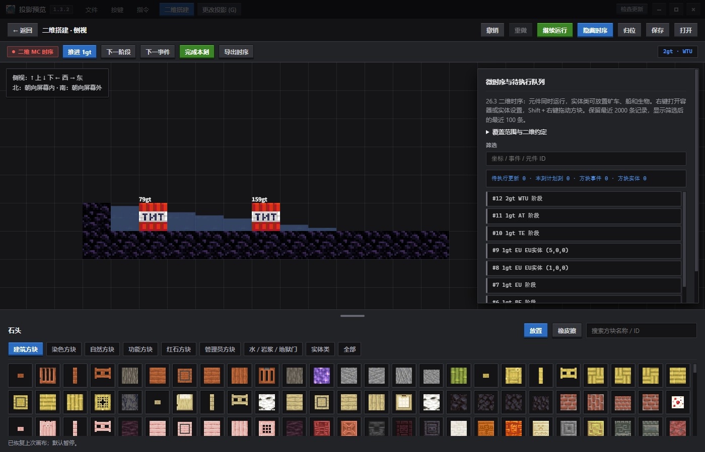

<div align="center">
  
  <h1>投影预览</h1>
  <p>Standalone Litematic Renderer — Minecraft Java 结构查看、材料统计与二维红石实验工具</p>
  <p>
    <a href="https://github.com/wocenimenma0220/Standalone-Litematic-Renderer/releases">下载便携版</a>
    · <a href="docs/DEVELOPMENT.md">开发文档</a>
    · <a href="https://github.com/wocenimenma0220/Standalone-Litematic-Renderer/issues">问题反馈</a>
  </p>
  <p>Windows x64 · Java 渲染引擎 · Electron 桌面应用 · 作者 LiteKinda</p>
</div>

无需启动 Minecraft 或安装 Litematica，直接打开 `.litematic`、Java 结构 `.nbt` 或 Sponge `.schem` 文件即可旋转预览模型、第一人称漫游、按层切片检查、统计材料，并导出图片、动图或编辑后的投影。自带 Java 与 Electron 运行时，解压即用。

附带侧视与俯视二维搭建画布，适合做小型红石、容器、矿车、TNT 与流体测试，并支持按游戏刻（gt）和事件阶段逐步单步排查。

- 作者 **LiteKinda**：[B 站主页](https://space.bilibili.com/107835436?spm_id_from=333.788.0.0)
- **XeKr 红显材质包**（**XeKr**）：[B 站主页](https://space.bilibili.com/5930630?spm_id_from=333.788.upinfo.head.click) · [Modrinth 下载](https://modrinth.com/resourcepack/xk-redstone-display/versions)
- **护眼大补丸**（**黑山大叔**）：[B 站主页](https://space.bilibili.com/19428259?spm_id_from=333.788.upinfo.detail.click)

---

## 快速开始

1. 从 [Releases](https://github.com/wocenimenma0220/Standalone-Litematic-Renderer/releases) 下载对应版本的 Windows x64 安装包（`*-setup.exe`，支持应用内自动增量补丁更新与一键安装/卸载）或绿色便携包（`*.zip`，检测更新后引导下载；带 `-beta`、`-test` 等后缀的为测试版）。
2. 将压缩包完整解压到可写目录（保留同级的 `bin`、`runtime`、`assets`、`webapp` 等文件夹），双击 `投影预览.exe`。
3. 拖入或选择投影文件；通过左侧栏可调整选区、光照、材料清单或切换渲染/编辑模式。

> 便携版已自带运行环境，不用额外装 Java 或 Node.js。想先试效果可以直接打开仓库里的 [功能演示投影](docs/examples/功能演示.litematic)（含箱子、漏斗、红石、玻璃、水、TNT 和矿车，用于展示渲染与状态查看）。

---

## 主要功能

当前版本：**1.3.1.1（正式版）**（以下功能截图拍摄于早期版本界面）。

### 三维预览与漫游


- 自由旋转、缩放观察整体，或按 `V` 切换第一人称飞行漫游钻进机器内部查看走线。
- 完整解析方块状态、透明材质排序、发光方块、平滑光照，以及部分方块实体和静态实体外观；支持加载外部资源包。
- 大型投影自动切换分块流式加载：先显示粗略总览，再按视角精细补全与 LOD 降级，也可在设置里强制完整加载、调节视距与缓存大小（默认退出清理渲染缓存，可改为持久化复用）。
- 交互使用 GPU 实时渲染，导出 PNG / GIF 时走 Java 软件渲染管线。

### 选区、逐层查看与图片导出


- 按 `B` 打开选点工具，设置两个角点框定局部区域；选区外的方块会自动淡化或裁切，关闭面板后仍保持选区效果。
- 支持 Y 轴逐层切片浏览，方便逐层核对红石和建筑结构。
- 支持按中文名、英文名或方块 ID 搜索并定位目标方块；点击可查看方块状态、NBT 及容器内物品与组件（若原投影未导出库存会明确提示）。
- 后台导出自定义分辨率和视角的 PNG（支持 `8192～81920` 超高分辨率、贴图清晰上限自动计算尺寸的`无损`流式 PNG，以及透明背景）和 360° 旋转 GIF，导出期间不阻塞画面浏览。

### 材料清单与容器统计



- 将“建筑所需材料”与“容器内部物品”分开统计，互不混算。
- 支持名称/ID 筛选，并按个 / 组 / 潜影盒自动换算数量。
- 可一键将建材列表中的水桶按 1:1 换算为普通冰块（不影响容器内物品），并支持合并或拆分导出为 XLSX / CSV。

### 三维投影编辑



- 按 `G` 进入“更改投影”后可在三维视图里直接放置、删除或吸取方块，内置 36 格背包与 9 格快捷栏。
- 内置调试棒工具，直接切换朝向、开关、连接状态等方块属性。
- 编辑支持撤销与重做，处理常见多格方块及活塞联动。
- 所有改动仅存在于编辑副本，必须手动导出 `.litematic` 才会落盘，不会误改源文件；由 `.nbt` / `.schem` 导入的结构同样统一导出为 `.litematic`。

### 二维搭建与微时序排查



- 提供“侧视”与“俯视”两种平面画布，左键放方块、右键触发元件或打开容器，支持平移缩放、框选拖动和撤销重做。
- 已接入常见红石元件（粉、火把、中继器、比较器、侦测器、铜灯等）、平面活塞推动（含短脉冲丢块与部分准连接 / BUD）、容器漏斗传输冷却、铁轨矿车，以及 TNT 引爆、爆炸冲量和基础水流/熔岩扩散。
- 画布默认暂停：可连续运行，也能单步推进 1 gt、下一阶段或下一事件；打开时序面板可查看各阶段微时序记录并按坐标/元件筛选导出。
- 侧视与俯视画布均会定期自动暂存并在下次重启恢复（保持暂停），重要设计也支持导出/导入 JSON（[更多实验示例见 docs/examples](docs/examples/)）。

更多细节见[二维搭建范围说明](docs/二维微时序测试版说明.md)与[二维 TNT 与流体实现](docs/二维TNT与流体实现.md)。

---

## 支持的格式

| 格式 | 用途 | 备注 |
| --- | --- | --- |
| `.litematic` | 三维查看、检查、材料统计与编辑 | 编辑结果默认导出为该格式 |
| `.nbt` | 导入 Minecraft Java 结构文件 | 多调色板默认读取第一套，不支持任意 SNBT |
| `.schem` | 导入 Sponge v2 / v3 结构 | 不做游戏 DataFixer 跨版本迁移 |
| `.json` | 二维画布存档 | 在“二维搭建”界面单独打开 |

> Java `.nbt` 和 Sponge `.schem` 目前限制总体积不超过 1600 万格、单轴范围 1–16384，暂不支持老版本数字 ID 的 `.schematic` 或基岩版结构。

---

## 常用快捷键

默认键位可在界面设置中自定义：

| 场景 | 功能 | 默认按键 |
| --- | --- | --- |
| 三维视图 | 切换漫游模式 | `V` |
| 三维视图 | 切换更改投影 | `G` |
| 三维视图 | 切换选点工具 | `B` |
| 三维视图 | 打开命令栏 | `/` |
| 漫游移动 | 移动 / 上升 / 下降 / 加速 | `W A S D`、`Space`、`Shift` / `C`、`Ctrl` |
| 选区 | 设置角点1 / 角点2 | 左键 / 右键 |
| 选区 / 切片 | 调整角点或切换切片高度 | `Alt` + 滚轮 |
| 编辑快捷栏 | 选择槽位 / 调试棒 / 切换 | `1–9`、`0`、滚轮 |
| 通用编辑 | 撤销 / 重做 | `Ctrl + Z`、`Ctrl + Shift + Z` |
| 二维画布 | 放置 / 交互或开容器 | 左键 / 右键 |
| 二维画布 | 移动方块 / 平移 / 缩放 | `Shift` + 右键拖动、中键拖动、滚轮 |
| 窗口 | 全屏 / 释放鼠标锁定 | `F11`、`Esc` |

---

## 从源码构建

需要 **Windows、PowerShell 7、JDK 21+、Node.js**（打包便携版另需 JDK 自带 `jlink` 及系统 `.NET Framework` C# 编译器）。

```powershell
git clone https://github.com/wocenimenma0220/Standalone-Litematic-Renderer.git
cd Standalone-Litematic-Renderer

# 安装 Electron 依赖
.\install.bat

# 从本地 Minecraft Java 客户端 JAR 准备贴图与模型资源
.\tools\prepare-resources.ps1 -ClientJar 'C:\path\to\client.jar'

# 构建便携发行包（输出到 dist/）
.\package.ps1 -JdkHome 'C:\path\to\jdk'
```

运行回归测试：

```powershell
.\verify.ps1 -JdkHome 'C:\path\to\jdk'
```

详细测试参数（`-Profile Full`、`-Ui`、`-DesktopUi`）和目录结构见[开发与验证文档](docs/DEVELOPMENT.md)。

---

## 目前已知边界

- 二维画布仅模拟当前平面（侧视 z=0，俯视 y=0），不包含区块加载、随机刻、熔炉/合成器生产配方或生物 AI。
- 部分模组方块或冷门实体的特殊模型缺少静态渲染适配，GPU 实时预览与软件导出画面之间偶尔会有轻微色差。
- 若原始投影导出时漏存了箱子或实体 NBT，软件无法凭空补回。
- 便携版目前仅针对 Windows x64 构建验证。

---

## 致谢与许可

仓库根目录暂未附带单独的 `LICENSE` 文本；`webapp/package.json` 标注为 ISC。内置第三方资源需遵守对应作者许可：

- 部分静态方块实体模型改写自 EnhancedBlockEntities（LGPL-3.0）：[EBE-NOTICE](assets/builtin/static-block-entities/EBE-NOTICE.md) · [EBE-LICENSE](assets/builtin/static-block-entities/EBE-LICENSE.txt)
- 内置字体及 Unifont 说明：[字体说明](assets/builtin/minecraft-font/README.txt)

Minecraft 为 Mojang / Microsoft 商标，本项目为独立社区工具。如有建议或 Bug，欢迎附带版本号、复现步骤与最小投影样本提交 [Issue](https://github.com/wocenimenma0220/Standalone-Litematic-Renderer/issues)。
