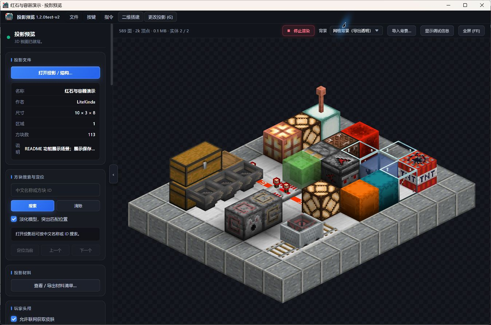
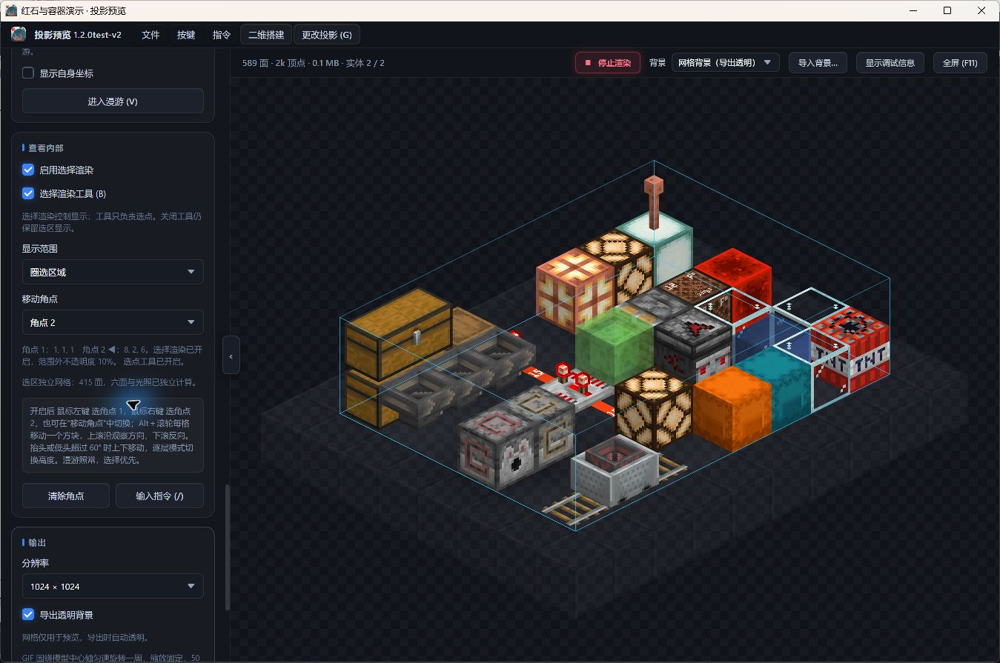
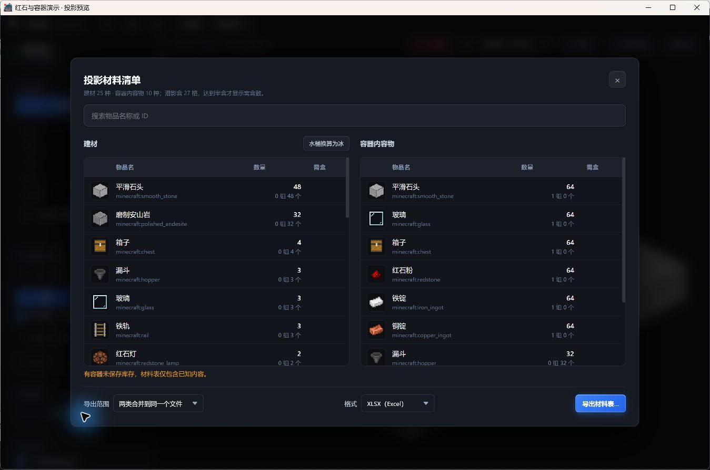
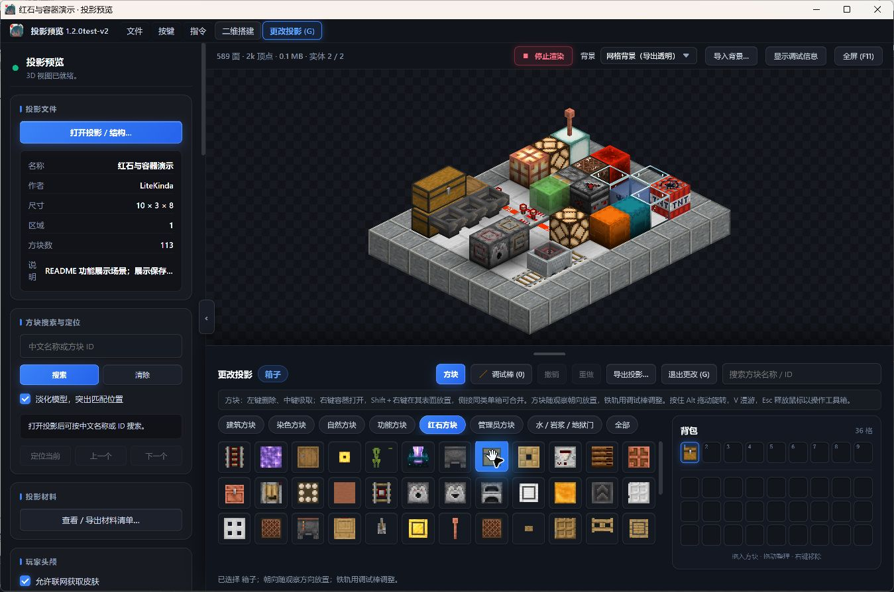
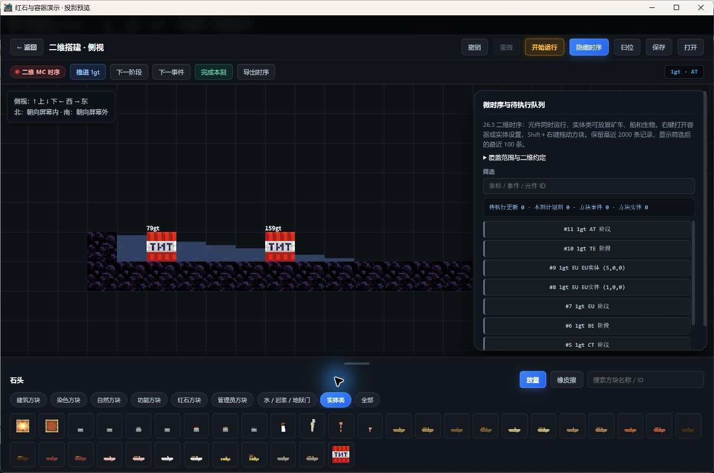

<a id="readme-top"></a>

<div align="center">
  
  <h1>投影预览</h1>
  <p><strong>Standalone Litematic Renderer</strong></p>
  <p>在游戏外查看 Minecraft 投影、检查内部结构、整理材料，或搭建二维红石实验。</p>
  <p>
    <a href="https://github.com/wocenimenma0220/Standalone-Litematic-Renderer/releases"><strong>下载 Windows 便携版</strong></a>
    · <a href="docs/DEVELOPMENT.md">开发文档</a>
    · <a href="https://github.com/wocenimenma0220/Standalone-Litematic-Renderer/issues">反馈问题</a>
  </p>
  <p>Windows x64 · Java 渲染引擎 · Electron 桌面界面 · 作者 LiteKinda</p>
</div>

投影预览是一款独立运行的 Minecraft Java 版结构查看与导出工具。打开 `.litematic`、Java 结构 `.nbt` 或 Sponge `.schem`，即可旋转查看模型、自由漫游、按层观察、统计材料，并导出图片或编辑后的投影。便携包包含所需运行时，无需先启动 Minecraft，也无需安装 Litematica 模组。

此外，软件提供侧视与俯视的二维搭建画布，用于局部红石、容器、矿车、TNT 与流体实验，并可逐刻检查执行过程。二维实验与三维投影编辑的功能范围不同，详见[当前限制](#limitations)。

<details>
  <summary>目录</summary>

  - [快速开始](#quick-start)
  - [功能与截图](#features)
    - [三维预览与自由漫游](#preview)
    - [选区、逐层观察与图片导出](#inspection)
    - [材料清单与容器内容物](#materials)
    - [三维投影编辑](#editor)
    - [二维搭建与微时序](#board)
  - [支持的文件格式](#formats)
  - [常用操作](#controls)
  - [从源码构建](#development)
  - [当前限制](#limitations)
  - [反馈与贡献](#contributing)
  - [许可与致谢](#credits)

</details>

<a id="quick-start"></a>

## 快速开始

1. 前往 [Releases](https://github.com/wocenimenma0220/Standalone-Litematic-Renderer/releases)，下载所需版本的 Windows x64 便携 ZIP。测试版也会显示在此页面，请留意版本说明。
2. 将压缩包**完整解压**到可写目录，双击 `投影预览.exe`。请保留同目录下的 `bin`、`runtime`、`assets` 和 `webapp` 等文件夹。
3. 在界面中打开投影文件，等待模型加载后旋转、缩放或进入漫游。
4. 通过侧栏选择显示范围、调整光照、查看材料，或从菜单导出 PNG / GIF。

**便携版不需要另外安装 Java 或 Node.js。** 源码开发环境的要求见[从源码构建](#development)。

想先试用功能，可以下载仓库里的[功能演示投影](docs/examples/功能演示.litematic)。它包含箱子、漏斗、红石元件、玻璃、水、TNT 和矿车等，用于观察外观与保存状态；它不是一台可运行机器的设计图。

<a id="features"></a>

## 功能与截图

当前正式版本为 **1.2.0**。以下五张截图拍摄于正式发布前的 `1.2.0test-v2`，展示本次正式版包含的功能；三维截图使用仓库附带的功能演示投影。

<a id="preview"></a>

### 1. 三维预览与自由漫游



- **整体观察与近景漫游**：旋转、缩放模型，或进入第一人称自由飞行，检查建筑内部和大型机器的局部结构。
- **材质与光照**：显示方块状态、透明材质、发光效果和平滑光照，可调整光照、背景及资源包；支持部分方块实体和普通实体的静态外观。
- **多种加载方式**：提供自动选择、完整加载与大投影分块加载。大投影可先显示总览，再按视角补充细节，并通过 LOD 降低远景开销。
- **可调性能与缓存**：可设置预览几何缓存上限、漫游水平视距与磁盘场景缓存限额。默认退出时清理渲染缓存；关闭该选项后，下次启动可复用场景缓存。
- **预览与导出**：GPU 用于交互式查看，Java 软件渲染用于图片与动画导出，适合在同一份投影上完成检查和展示。

<a id="inspection"></a>

### 2. 选区、逐层观察与图片导出



- **双角点选区**：用两个角点限定观察范围，支持输入坐标、移动角点和独立调整各方向裁切面。选区外方块可淡化显示，保留周围结构作为参照。
- **逐层查看**：按 Y 高度切换切片，适合逐层阅读建筑与红石线路；选区工具关闭后仍可保留选区显示。
- **搜索与定位**：按中文名称、方块名称或 ID 查找目标，定位匹配方块并观察它们在结构中的分布。
- **方块与容器检查**：查看方块状态、NBT 和已保存的容器内容物、物品组件。文件未保存容器数据时会提示，不能据此判断原容器为空。
- **PNG 与 360° GIF**：设置输出尺寸、视角和背景，导出静态图片或旋转动画；支持透明背景，选择渲染范围也可应用到导出。任务在后台执行，期间可继续预览，退出软件会停止未完成的任务。

<a id="materials"></a>

### 3. 材料清单与容器内容物



- **两类统计**：分别列出搭建所需建材和投影中已保存的容器内容物，避免把库存物品混入方块数量。
- **名称搜索与数量换算**：按名称或 ID 筛选，并查看数量、组数及盒数，方便备料与运输。
- **水桶换算为冰**：可将建材中的普通水桶按一桶水对应一块普通冰换算，导出沿用换算结果；容器内容物不受此换算影响。
- **XLSX / CSV 导出**：两类清单可合并到一个文件、分别导出，或只导出其中一类。
- **缺失数据提示**：材料表会标明容器数据不完整的情况。统计依据文件中实际保存的数据，无法补回导出投影时遗漏的库存。

<a id="editor"></a>

### 4. 三维投影编辑



- **直接修改结构**：进入“更改投影”后，在三维视图中放置、删除和拾取方块，通过分类或搜索选择材料。
- **调试棒**：查看和修改方块状态，例如朝向、连接或开关状态，便于调整保存下来的结构外观。
- **背包与快捷栏**：提供 36 格背包和 9 格快捷栏，可用数字键或滚轮切换常用方块。
- **撤销与重做**：回退或恢复编辑操作；已接入的成对方块及活塞结构编辑会处理相关联动。
- **另存投影**：编辑后显式导出 `.litematic`，原文件不会随操作自动覆盖。由 `.nbt` / `.schem` 导入的结构也统一导出为 `.litematic`，并保留原始导入数据。

三维编辑修改的是投影保存状态。需要观察运行过程时，请使用下面的二维实验画布。

<a id="board"></a>

### 5. 二维搭建与微时序



- **侧视 / 俯视画布**：在网格中搭建局部结构，按分类或名称搜索方块。左键放置、右键操作元件或打开容器，支持拖动、平移、缩放及撤销重做。
- **红石与活塞**：已接入红石粉、火把、中继器、比较器、侦测器、灯、铜灯，以及平面内的活塞推动、黏性分支、短脉冲和部分准连接 / BUD 行为。
- **容器与运输**：操作箱子、漏斗、投掷器等库存，查看漏斗锁定与传输冷却，实验铁轨、矿车和容器实体交互。
- **TNT 与流体**：观察引信、连锁点燃、爆炸遮挡与冲量，以及水流液位、退流、含水和流体推力等已接入行为。
- **逐步检查**：画布默认暂停，可连续运行，也可推进 1 个游戏刻（gt）、进入下一阶段、执行下一事件或完成本刻。时序面板显示阶段、事件与待执行队列，支持按坐标、事件或元件 ID 筛选并导出记录。
- **保存与恢复**：手动保存 / 打开 JSON，可保留方块、容器、实体和执行队列；侧视与俯视分别暂存上次画布，重启后恢复为暂停状态。运行时约每两秒暂存，关闭画布与正常退出时即时保存，重要设计建议另存 JSON。

截图示例：[TNT—水流运输与爆炸冲量](docs/examples/TNT-水流运输与爆炸冲量.json)。进入“二维搭建 → 侧视”，点击“打开”载入 JSON，再打开“显示时序”逐刻观察。更多实验位于 [docs/examples](docs/examples/)。

二维功能仍在扩展中，仅计算当前平面。完整覆盖清单见[二维搭建与微时序范围](docs/二维微时序测试版说明.md)，TNT 与流体的细节见[实现说明](docs/二维TNT与流体实现.md)。

<a id="formats"></a>

## 支持的文件格式

| 格式 | 用途 | 说明 |
| --- | --- | --- |
| `.litematic` | 三维查看、检查、材料统计与编辑 | 编辑结果也使用此格式导出 |
| `.nbt` | Minecraft Java 结构文件导入 | 多套调色板使用第一套；不包含任意 NBT 文件或 SNBT 文本 |
| `.schem` | Sponge v2 / v3 结构导入 | 不执行游戏 DataFixer 迁移，旧版名称和 NBT 可能存在兼容差异 |
| `.json` | 二维画布保存与恢复 | 在二维搭建界面打开，与三维结构文件入口分开 |

Java 结构 NBT 与 Sponge 导入目前限制为最多 **1600 万格**，单轴尺寸为 **1–16384**。旧式数字 ID 的 `.schematic`、Bedrock 结构和其他同名扩展文件不在当前支持范围。

导出内容包括 PNG、旋转 GIF、XLSX / CSV 材料表、编辑后的 `.litematic`、二维画布 JSON 和时序记录。

<a id="controls"></a>

## 常用操作

以下为默认按键，可在界面的快捷键设置中查看和调整。

| 场景 | 操作 | 默认按键 / 鼠标 |
| --- | --- | --- |
| 三维 | 开关自由漫游 | `V` |
| 三维 | 开关更改投影 | `G` |
| 三维 | 开关选点工具 | `B` |
| 三维 | 打开指令输入 | `/` |
| 三维 | 漫游移动、上升、下降、加速 | `W A S D`、`Space`、`Shift` / `C`、`Ctrl` |
| 选区 | 设置两个角点 | 左键 / 右键 |
| 选区 | 移动当前角点；逐层模式切换高度 | `Alt` + 滚轮 |
| 编辑 | 选择快捷栏、调试棒、切换槽位 | `1–9`、`0`、滚轮 |
| 编辑 / 二维 | 撤销、重做 | `Ctrl + Z`、`Ctrl + Shift + Z` |
| 二维 | 放置、交互 / 打开容器 | 左键、右键 |
| 二维 | 移动方块、平移画布、缩放 | `Shift` + 右键拖动、中键拖动、滚轮 |
| 窗口 | 全屏、释放鼠标 | `F11`、`Esc` |

<a id="development"></a>

## 从源码构建

开发环境需要 **Windows、PowerShell 7、JDK 21 或更新版本、Node.js**。打包还需要 JDK 的 `jlink` 和 Windows .NET Framework C# 编译器。

```powershell
git clone https://github.com/wocenimenma0220/Standalone-Litematic-Renderer.git
cd Standalone-Litematic-Renderer

# 安装桌面界面依赖
.\install.bat

# 从本地 Minecraft Java 客户端 JAR 准备原版模型、贴图等资源
.\tools\prepare-resources.ps1 -ClientJar 'C:\path\to\client.jar'

# 编译并生成包含运行时的便携包，输出位于 dist
.\package.ps1 -JdkHome 'C:\path\to\jdk'
```

基本检查入口为：

```powershell
.\verify.ps1 -JdkHome 'C:\path\to\jdk'
```

默认检查使用项目自有的小型资源夹具；真实资源回归、界面检查、版本管理和代码入口见[开发与验证](docs/DEVELOPMENT.md)。

<a id="limitations"></a>

## 当前限制

- **二维模拟只覆盖当前平面**：面外更新、随机刻、区块加载卸载和三维投影联动尚未接入，复杂机器需要在游戏中复核。
- **部分机制仅保存状态**：二维熔炉、合成器和酿造台保留库存，但不执行实际生产；生物和船没有 AI。完整战斗、战利品、燃烧和环境机制仍有缺项。
- **三维显示受资源与实现范围影响**：部分实体、特殊模型或模组方块可能缺少外观或行为支持。资源包不能自动赋予模组逻辑，软件渲染导出与 GPU 预览也可能存在视觉差异。
- **投影文件可能缺少数据**：原导出过程未保存的实体、容器库存等无法恢复。旧版本结构不会自动完成原版的数据迁移。
- **大投影仍有资源开销**：分块加载和缓存可以改善查看体验，光照、贴图与导出仍会占用内存和时间，实际表现取决于投影和设备。
- **当前发布以 Windows x64 为目标**：其他系统暂未提供同等验证的便携发行包。

<a id="contributing"></a>

## 反馈与贡献

欢迎通过 [Issues](https://github.com/wocenimenma0220/Standalone-Litematic-Renderer/issues) 反馈问题或建议。复现问题时，请附上软件版本、操作步骤、预期与实际结果，以及可公开的最小投影 / 二维 JSON 示例；涉及显示问题时附上截图。

提交代码前请阅读[开发与验证](docs/DEVELOPMENT.md)，针对改动运行相关检查。二维行为的改动还应说明适用平面、时序和机制边界，便于与现有功能范围核对。

<a id="credits"></a>

## 许可与致谢

仓库目前尚未提供统一的根目录 `LICENSE` 文本；`webapp/package.json` 中标注了 ISC。各类第三方代码、模型、字体和 Minecraft 资源仍需分别遵循其来源声明，项目整体许可有待补充明确。

- 部分静态方块实体模型改编自 FoundationGames 及贡献者的 EnhancedBlockEntities，相关来源与 LGPL-3.0 文本见 [EBE-NOTICE](assets/builtin/static-block-entities/EBE-NOTICE.md) 和 [EBE-LICENSE](assets/builtin/static-block-entities/EBE-LICENSE.txt)。
- Minecraft 字体资源与 Unifont 的来源说明见[字体资源说明](assets/builtin/minecraft-font/README.txt)；字体归档内保留了对应许可文本。
- 本 README 的组织方式参考 [Best-README-Template](https://github.com/othneildrew/Best-README-Template)，截图与功能说明根据本项目当前界面编写。

Minecraft 为 Mojang / Microsoft 的商标；本项目为独立社区工具。

<p align="right"><a href="#readme-top">返回顶部 ↑</a></p>
