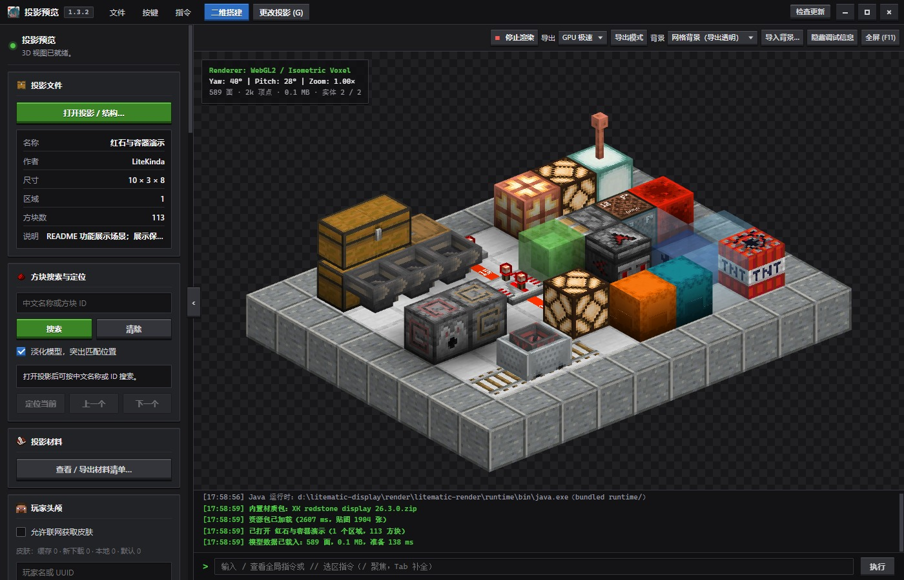
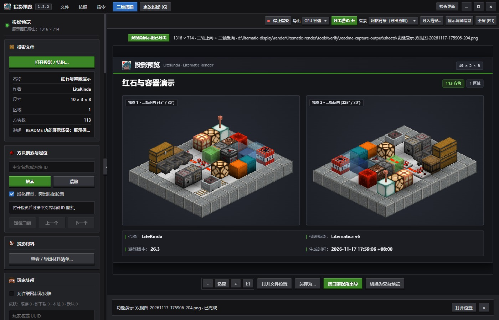
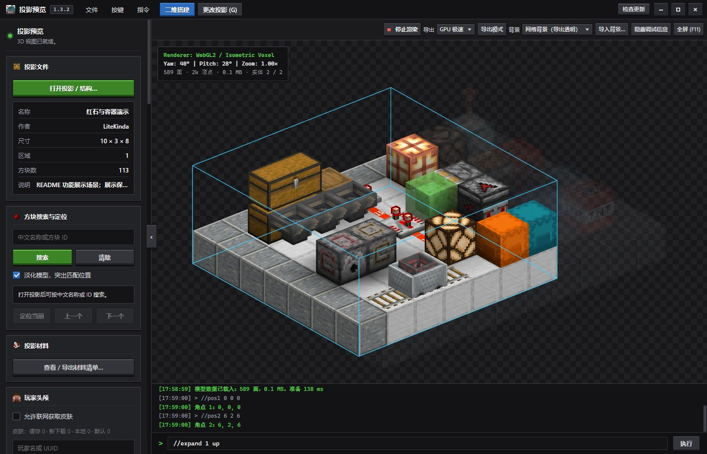

<div align="center">
  
  <h1>投影预览 · Litematic Viewer</h1>
  <p><b>Standalone Litematic Renderer</b> — Minecraft Java 结构三维预览、双视角展示卡生成、选区编辑、材料统计与二维微时序红石实验工具</p>
  <p>
    <a href="https://github.com/wocenimenma0220/Standalone-Litematic-Renderer/releases/latest">下载最新版 (v1.3.2.1)</a>
    · <a href="docs/修复记录.md">更新日志</a>
    · <a href="docs/DEVELOPMENT.md">开发与构建</a>
    · <a href="https://github.com/wocenimenma0220/Standalone-Litematic-Renderer/issues">问题反馈</a>
  </p>
  <p>Windows x64 · Java 21 渲染引擎 · Electron 44 (Bedrock Ore UI) · 作者 LiteKinda</p>
</div>

无需启动 Minecraft 或安装 Litematica，直接打开 `.litematic`、Java 结构 `.nbt` 或 Sponge `.schem` 文件即可在无边框 Ore UI 工作区内旋转预览模型、第一人称漫游、按层/框选排查、统计材料清单、快速生成自适应双视角展示图并自动复制到剪贴板，或直接进行三维与二维微时序编辑。自带精简 Java 与 Electron 运行时，提供**安装版（支持应用内自动增量补丁更新）**与**绿色便携 ZIP 版**两种分发形态。

- 作者 **LiteKinda**：[B 站主页](https://space.bilibili.com/107835436?spm_id_from=333.788.0.0)
- **XeKr 红显材质包**（**XeKr**）：[B 站主页](https://space.bilibili.com/5930630?spm_id_from=333.788.upinfo.head.click) · [Modrinth 下载](https://modrinth.com/resourcepack/xk-redstone-display/versions)
- **护眼大补丸**（**黑山大叔**）：[B 站主页](https://space.bilibili.com/19428259?spm_id_from=333.788.upinfo.detail.click)

---

## 获取与快速开始

前往 [GitHub Releases](https://github.com/wocenimenma0220/Standalone-Litematic-Renderer/releases/latest) 下载适配 Windows 10/11 (x64) 的任意一种发行包（均内置运行时，无需单独安装 Java 或 Node.js）：

| 分发形态 | 文件名 | 适用场景与更新方式 |
| --- | --- | --- |
| **Windows 安装版（推荐）** | `Litematic-Viewer-<版本>-win-x64-setup.exe` | 图形化向导安装（默认写入 `%LocalAppData%\Programs\投影预览`，免管理员权限），支持桌面/开始菜单快捷方式、双击 `.litematic / .nbt / .schem` 关联打开、控制面板规范卸载，以及**应用内检测更新并下载 ~11 MB 增量补丁重启热替换** |
| **绿色便携 ZIP 版** | `Litematic-Viewer-<版本>-win-x64.zip` | 完整解压至任意可写目录后双击 `投影预览.exe` 即可运行；内置版本检测并在有新版本时弹窗引导下载新版压缩包 |

- **单实例复用**：应用运行期间从外部资源管理器双击或命令行再次打开投影文件时，会自动唤醒已有窗口直接切换加载，不会重复弹出新窗口。
- **开箱体验**：想先测试渲染效果可直接打开仓库内自带的 [功能演示投影](docs/examples/功能演示.litematic)（含箱子、漏斗、红石、玻璃、水、TNT 与矿车）。

---

## 核心功能与新版界面（1.3.2）

### 1. Bedrock Ore UI 深色工作区、三维预览与漫游



- **Ore UI 深灰像素风界面**：无边框窗口集成顶部自定义标题栏（含版本徽章与最小化 / 最大化 / 关闭控制键）、16×16 原版像素栏目图标、立体绿/蓝交互按钮，以及采用 `appearance: base-select` 重构的深色无蓝框下拉控件。
- **实时 GPU 预览与第一人称漫游**：支持环绕拖拽旋转、滚轮缩放、15 套内置标准预设视角切换，或按 `V` 进入第一人称飞行漫游深入机器内部排查走线（可显示实时 XYZ 坐标并右键拾取方块/实体状态与容器库存）。
- **大投影分块流式加载与着色准确化**：超大投影自动启用分块总览与 LOD 渐进补全，可配置显存上限、视距与磁盘场景缓存；支持 `grass.png` / `foliage.png` / `dry_foliage.png` 群系着色及跨版本兼容映射、玩家头颅皮肤缓存与外部资源包堆叠。

### 2. GPU 极速导出与纯粹「导出模式」双视角展示卡



- **GPU 极速 / CPU 精确导出切换**：工具栏支持一键切换导出后端：
  - **GPU 极速**：复用当前 WebGL 几何与贴图离屏 FBO，毫秒级出图 PNG（支持透明、游戏天空、纯色与自定义背景图），并可配合多核后台 `GifWriter` 极速导出 50fps / 480 帧 360° 旋转 GIF（最高 4096 × 4096）。
  - **CPU 精确**：支持分条带流式编码，导出 **`8192 ～ 81920`** 超高分辨率及 **`无损（贴图最高清晰）`** PNG。
- **纯粹「导出模式」（点击工具栏 `导出模式`）**：
  - 开启后拖入或打开投影**直接输出自适应双视角展示图 PNG 并自动写入系统剪贴板**，不挂载 3D 交互画布，适合批量晒图与群聊分享。
  - **15 套 WikiRenderer / KCL 预设视角**：支持自定义左右面板视角、输出位置（默认投影同目录）、一键「按当前视角重导」，跟随左侧分辨率设置动态缩放卡片尺寸。
  - **内置看图缩放台**：支持以鼠标位置为中心的滚轮缩放（0.5× – 12×）、鼠标拖动平移、双击重置适应及 `1:1` 原图像素切换。

### 3. 选区、方块定位与一/二级指令系统



- **选择渲染与切片（`B`）**：支持「圈选区域」（淡化外部方块并独立计算选区光照）与「逐层查看」（Y 轴切片）。
- **中文 / ID 搜索定位**：按中文名或方块 ID 搜索并高亮全部匹配方块，支持「上一个 / 下一个 / 定位当前」。
- **一级（`/`）与二级（`//`）指令控制台（按 `/` 聚焦，`Tab` 补全，`↑/↓` 翻阅历史）**：
  - 一级全局指令：`/help`、`/commands`、`/pos`、`/tp`、`/view`、`/zoom`、`/fly`、`/vd`、`/search`、`/locate`、`/bg`、`/light`、`/layer`、`/tool`、`/export`、`/sheet`、`/sheetmode`、`/materials`、`/fullscreen`、`/sidebar`、`/console`、`/reload`、`/stop`、`/update`。
  - 二级选区与批量编辑指令：`//pos1`、`//pos2`、`//select`、`//desel`、`//expand`、`//contract`、`//shift`、`//outset`、`//inset`、`//size`、`//count`、`//distr`、`//set`、`//replace`、`//undo`、`//redo`。

### 4. 材料清单与容器库存统计


- 严格区分 **「建材」** 与 **「容器内容物」**，防止混算；内置中英文/ID 搜索筛选，自动换算为 `组 / 个 / 潜影盒`。
- 支持一键将建材中的水桶按 1:1 换算为普通冰块（不影响容器内物品），并支持合并或拆分导出为 **XLSX（Excel）** 或 **CSV**。

### 5. 三维投影编辑（`更改投影`）


- 按 `G` 打开底部「更改投影」抽屉：左键删除、中键吸取、`Shift + 右键` 放置，支持 36 格个人背包与 9 格快捷栏、`调试棒` 切换方块属性及批量撤销/重做。
- 编辑仅存在于临时副本，导出时统一保存为 `.litematic`，不会误改原文件。

### 6. 二维搭建与微时序红石排查


- 提供「侧视」与「俯视」两种平面红石与实体沙盒（对齐 Minecraft Java 26.3 本地参考源码逻辑），支持红石元件、活塞与准连接 / BUD、容器漏斗冷却、铁轨矿车、TNT 爆炸冲量及基础水流/熔岩扩散。
- 支持按 **1 gt / 下一阶段 / 下一事件** 单步排查并查看实时事件队列与状态变化记录；画布会自动暂存并在下次打开时恢复（默认暂停），也支持导出/加载 `.json`（示例见 [docs/examples](docs/examples/)）。
- 更多实现边界见 [二维搭建范围说明](docs/二维微时序测试版说明.md) 与 [二维 TNT 与流体实现](docs/二维TNT与流体实现.md)。

---

## 支持的格式

| 格式 | 用途 | 备注 |
| --- | --- | --- |
| `.litematic` | 三维查看、展示卡导出、材料统计与编辑 | 编辑结果统一导出为 `.litematic` |
| `.nbt` | 导入 Minecraft Java 结构文件 | 多调色板默认读取第一套，不支持任意 SNBT |
| `.schem` | 导入 Sponge v2 / v3 结构 | 不做游戏 DataFixer 跨版本迁移 |
| `.json` | 二维画布存档 | 在“二维搭建”界面保存或打开 |

> Java `.nbt` 和 Sponge `.schem` 当前限制总体积不超过 1600 万格、单轴范围 1–16384，暂不支持老版本数字 ID `.schematic` 或基岩版结构。

---

## 常用快捷键

可在界面顶栏 **按键** 菜单中自由重绑：

| 场景 | 功能 | 默认按键 |
| --- | --- | --- |
| 三维视图 | 进入/退出漫游 · 切换更改投影 · 选点工具 | `V` · `G` · `B` |
| 指令栏 | 聚焦指令输入 · 自动补全 · 历史记录 | `/` · `Tab` · `↑ / ↓` |
| 漫游移动 | 移动 / 上升 / 下降 / 加速 | `W A S D`、`Space`、`Shift` / `C`、`Ctrl` |
| 选区 | 设置角点 1 / 角点 2 · 调整角点/切片高度 | 左键 / 右键 · `Alt + 滚轮` |
| 编辑快捷栏 | 选择槽位 / 调试棒 / 滚轮切换 | `1–9`、`0`、滚轮 |
| 通用编辑 | 撤销 / 重做 | `Ctrl + Z`、`Ctrl + Shift + Z` |
| 二维画布 | 放置 / 交互 · 拖动移动方块 · 平移 / 缩放 | 左键 / 右键 · `Shift + 右键` · 中键 / 滚轮 |
| 窗口 | 全屏 / 释放鼠标锁定 | `F11`、`Esc` |

---

## 从源码构建与热渲染开发

需要 **Windows、PowerShell 7（或 5.1）、JDK 21+、Node.js**（打包发行版需 JDK 自带 `jlink` 及系统 `.NET Framework` `csc.exe`）。

```powershell
git clone https://github.com/wocenimenma0220/Standalone-Litematic-Renderer.git
cd Standalone-Litematic-Renderer

# 安装 Electron 依赖
.\install.bat

# 从本地 Minecraft Java 客户端 JAR 准备原版贴图与模型资源
.\tools\prepare-resources.ps1 -ClientJar 'C:\path\to\client.jar'

# 开发热渲染调试（修改 CSS 自动热替换并保留 3D 现场，修改 HTML/JS 自动重载）
npm --prefix webapp run dev
```

打包全套发行产物（输出便携 ZIP、增量补丁 ZIP、Windows 安装包 `*-setup.exe`、`latest.json` 及 `SHA256SUMS` 至 `dist/`）：

```powershell
.\package.ps1 -JdkHome 'C:\path\to\jdk'
```

运行自动化回归验证：

```powershell
.\verify.ps1 -Profile Full -DesktopUi -JdkHome 'C:\path\to\jdk'
```

详细目录结构、回归测试开关与发版流水线说明见 [开发与验证文档](docs/DEVELOPMENT.md)。

---

## 目前已知边界

- 二维画布仅模拟当前选定平面（侧视 z=0，俯视 y=0），不包含区块加载、随机刻、熔炉/合成器生产配方或生物 AI。
- 部分模组方块或冷门实体缺少静态渲染适配，GPU 实时预览与软件导出画面之间偶尔存在轻微光影差异。
- 若原始投影导出时未保存箱子或实体 NBT，工具无法凭空补回库存。
- 便携版与安装版目前仅面向 Windows x64 构建与验证。

---

## 致谢与许可

`webapp/package.json` 标注为 `ISC`。内置第三方资源需遵守各自开源许可：

- 部分静态方块实体模型改写自 EnhancedBlockEntities（LGPL-3.0）：[EBE-NOTICE](assets/builtin/static-block-entities/EBE-NOTICE.md) · [EBE-LICENSE](assets/builtin/static-block-entities/EBE-LICENSE.txt)
- 内置字体及 Unifont 说明：[字体说明](assets/builtin/minecraft-font/README.txt)

Minecraft 为 Mojang / Microsoft 商标，本项目为独立社区工具。如有建议或 Bug，欢迎附带版本号、复现步骤与最小投影样本提交 [Issue](https://github.com/wocenimenma0220/Standalone-Litematic-Renderer/issues)。
